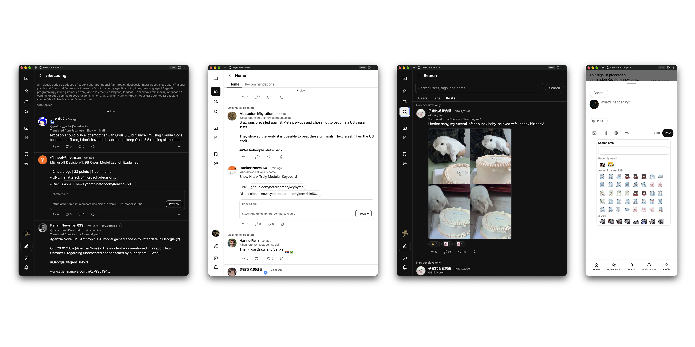

# Keystone v2



A fediverse client for **Misskey and Mastodon**, built as one
Expo + React Native app that ships to **iOS, Android and web** (`react-native-web`).

Keystone v2 is a rebuild of the original SolidJS Keystone. It follows the
architecture of Bluesky's `social-app` (Expo, React Navigation, TanStack Query,
MMKV, Lingui, an atomic style system) while keeping Keystone's backend-agnostic
data layer. See [`rn-rebuild-plan.md`](rn-rebuild-plan.md) for the full rationale.
No Bluesky source is vendored ([`NOTICE.md`](NOTICE.md),
[ADR 0001](docs/adr/0001-patterns-not-code.md)).

## Status

Definitely unfinished. Might be annoying to use, especially on mobile. Looks kind of bad too. 

## Layout

```
packages/fedi/   pure TypeScript data layer: core, misskey, mastodon, recorded fixtures
src/             the app: alf (design system), components, screens, state, storage, locale, lib
docs/            server specs, ADRs (docs/adr), decisions log, task files
state/           STATE.md pointer + append-only session logs
lint-rules/      custom ESLint rules, one test per rule
scripts/         fedi-smoke, probes, helpers
plugins/         Expo config plugins
```

## Architecture rules

These are enforced by lint and tests, not just convention:

- `src/` only sees `packages/fedi` domain models (`Post`, `Account`,
  `Notification`, `Capabilities`). Wire types never cross over (`no-wire-in-app`).
- `packages/fedi` is pure TS: no React, React Native, Expo or DOM (`no-ui-in-fedi`).
- Every query key includes `sessionId`; switching accounts never shows another
  account's data.
- Every action is gated on a `Capabilities` flag. No inert controls, no fake data.
- MFM/HTML parses to one allow-listed AST and renders through a single `RichText`.
  No `innerHTML`, no WebView.
- Tokens are per origin; a request built from one session never carries another's
  token or origin.
- Feeds are addressed by `FeedDescriptor` strings; deck columns are
  `{descriptor, sessionId, options}`.

## Getting started

Requirements: Node >= 24.19, pnpm, and Xcode / Android Studio for native builds.

```bash
pnpm install

pnpm start        # Expo dev client
pnpm web          # web
pnpm ios          # native iOS build
pnpm android      # native Android build
pnpm build-web    # static web export
```

## Verification

```bash
pnpm typecheck && pnpm lint && pnpm test
```

`typecheck` covers iOS, Android and web configs. Other useful scripts:

| Script | Purpose |
| --- | --- |
| `pnpm test-watch` | Jest in watch mode |
| `pnpm smoke` | Backend smoke test against the local server rig |
| `pnpm probe:w4` / `w5` / `w8` / `wsc` | Targeted backend probes |
| `pnpm intl:extract` / `intl:compile` | Lingui translation workflow |
| `pnpm prettier` | Formatting check |

Server rig setup (Misskey, Sharkey, Mastodon) is described in
[`docs/setup.md`](docs/setup.md).

## Working in this repo

Work is organized by slice, with state kept on disk so any session can resume.
Read [`AGENTS.md`](AGENTS.md) first: it defines the read order, the
`state/` protocol, task files in `docs/tasks/`, and when a decision needs an ADR.

## Docs

- [`rn-rebuild-plan.md`](rn-rebuild-plan.md): the rebuild plan
- [`docs/adr/`](docs/adr/README.md): architecture decision records
- [`docs/DECISIONS.md`](docs/DECISIONS.md): small decisions log
- [`docs/mastoapi-contract.md`](docs/mastoapi-contract.md), [`docs/api-surface.md`](docs/api-surface.md): backend contracts
- [`docs/mfm.md`](docs/mfm.md), [`docs/i18n.md`](docs/i18n.md): content and localization
